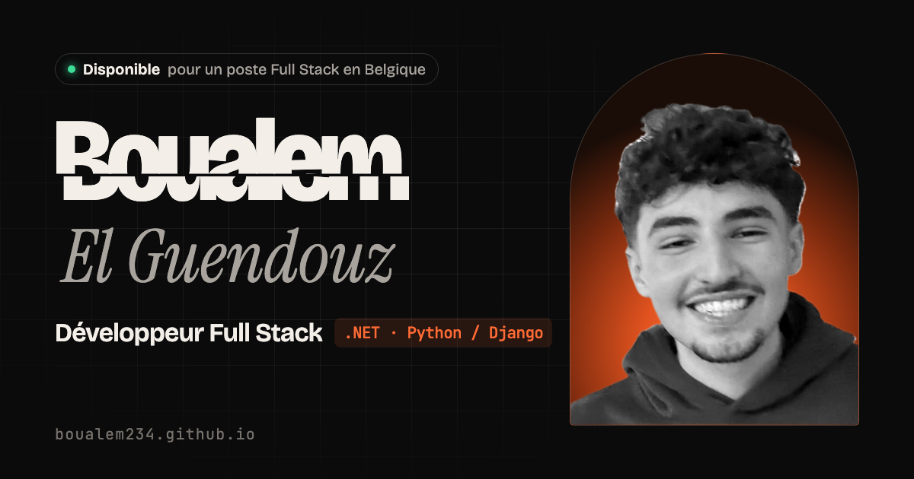

<div align="center">

# Boualem El Guendouz — Portfolio

Développeur Full Stack · .NET · Python / Django

**[boualem234.github.io](https://boualem234.github.io)**



</div>

## Contenu

- Présentation, stage chez WOOGMA (avec les captures de l'application), projets, compétences, formation et contact.
- Une page par projet avec ses captures d'écran en plein écran.
- CV téléchargeable en PDF.
- Accessible (navigation clavier, `prefers-reduced-motion`) et adapté au mobile.

## Stack

| | |
| --- | --- |
| Framework | React 19 · TypeScript · Vite |
| Animations | Motion · Lenis (défilement fluide) |
| Routage | React Router |
| Style | CSS Modules, design tokens en variables CSS |
| Qualité | ESLint · TypeScript strict · CI GitHub Actions |
| Hébergement | GitHub Pages, déployé par GitHub Actions |

## Démarrer

Prérequis : [Node.js](https://nodejs.org) 22 ou plus récent (npm est fourni avec).

```bash
npm ci             # installe les dépendances (versions exactes du package-lock.json)
npm run dev        # http://localhost:5173
```

Pour voir la version de production, telle qu'elle sera en ligne :

```bash
npm run build
npm run preview    # http://localhost:4173
```

| Script | Rôle |
| --- | --- |
| `npm run dev` | serveur de développement |
| `npm run build` | vérification TypeScript + build de production dans `dist/` |
| `npm run preview` | sert le build localement |
| `npm run lint` | ESLint |

## Modifier le contenu

Tout le texte est séparé du code :

| Fichier | Contenu |
| --- | --- |
| `src/i18n/ui.ts` | textes de l'interface, FR et EN (hero, à propos, expérience, contact…) |
| `src/data/projects.ts` | projets : descriptions, stack, liens, légendes des captures |
| `src/data/skills.ts` | compétences par domaine |
| `src/data/education.ts` | formation |
| `src/data/interests.ts` | centres d'intérêt |
| `src/data/profile.ts` | e-mail, liens, chemin du CV |
| `public/cv/` | CV téléchargeable (PDF) |
| `public/images/` | portrait et captures (WebP) |

Pour ajouter des captures : les exporter en WebP (une version pleine taille `n.webp` et une version 800 px `n-sm.webp`) dans `public/images/projects/<slug>/`, puis renseigner leurs dimensions et légendes dans `src/data/projects.ts`.

## Structure

```
src/
├── components/   éléments réutilisables (Header, BoostMeter, Lightbox…)
├── sections/     sections de la page d'accueil (Hero, Experience, Projects…)
├── pages/        accueil, étude de cas, 404
├── data/         contenu (projets, compétences, formation…)
├── i18n/         textes FR / EN et contexte de langue
├── hooks/        défilement, titre d'onglet, code Konami…
└── styles/       tokens et styles globaux
```

## Déploiement

Chaque push sur `main` lance le workflow [`.github/workflows/deploy.yml`](.github/workflows/deploy.yml) : lint, build, puis publication sur GitHub Pages. Les pull requests sont vérifiées sans être publiées.

Mise en place et dépannage : voir [DEPLOIEMENT.md](DEPLOIEMENT.md).

Le site est un site utilisateur GitHub Pages servi à la racine (`base: "/"` dans `vite.config.ts`). `public/404.html` redirige les URL profondes (`/projets/...`) vers l'application pour que le routage fonctionne sur GitHub Pages.

## Licence

MIT — voir [LICENSE.md](LICENSE.md).
